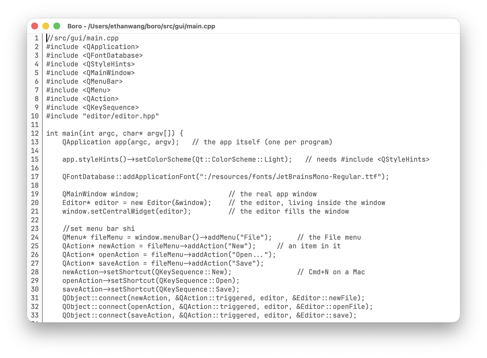

<div align="center">

# boro

A code editor written in C++, built from scratch.

<a href="https://github.com/ethandadev/boro" target="_blank" rel="noopener noreferrer"></a>
<a href="https://www.youtube.com/@ethandadev" target="_blank" rel="noopener noreferrer"></a>
<a href="https://buymeacoffee.com/ethandadev" target="_blank" rel="noopener noreferrer"></a>
<a href="https://boro.ethandadev.com" target="_blank" rel="noopener noreferrer"></a>
<br>
<a href="./LICENSE.md"></a>


<a href="https://github.com/ethandadev/boro"></a>


</div>

---

> **The Goal**: Code boro using boro



---

## Install

**Homebrew**

Terminal Version:
```
brew install ethandadev/tap/boro
```

GUI Version:
```
brew install --cask ethandadev/tap/boro-app
```

**Installer:** download `boro-0.3.0.pkg` from [Releases](https://github.com/ethandadev/boro/releases).

If you really want to use the terminal version for some reason then just download `boro-0.1.0.pkg`
> **boro terminal** will no longer be regularly updated

---

## Contributing

Anyone who wants to contribute is welcome. 
From beginner to professional. 
I will support anyone who helps find issues, 
develop new features and provide feedback.

### Build

To build boro run

```sh
make gui
```
for gui version and

```sh
make
```
for terminal version

You might have to run `make qt` if it make complains.

---

## Status

The GUI is officially available in the latest release, 
though it is missing Undo/Redo features and horizontal
scrolling, I am actively working on these features
and should be ready on the next update.

---

## TODO

For anyone else(or me) to work on:

- [x] GUI
- [x] Better Comments
- [x] Undo/Redo Features
- [ ] File Hierarchy
- [ ] Horizontal Scrolling

---

## License

[MIT License](https://github.com/ethandadev/boro/blob/main/LICENSE)
